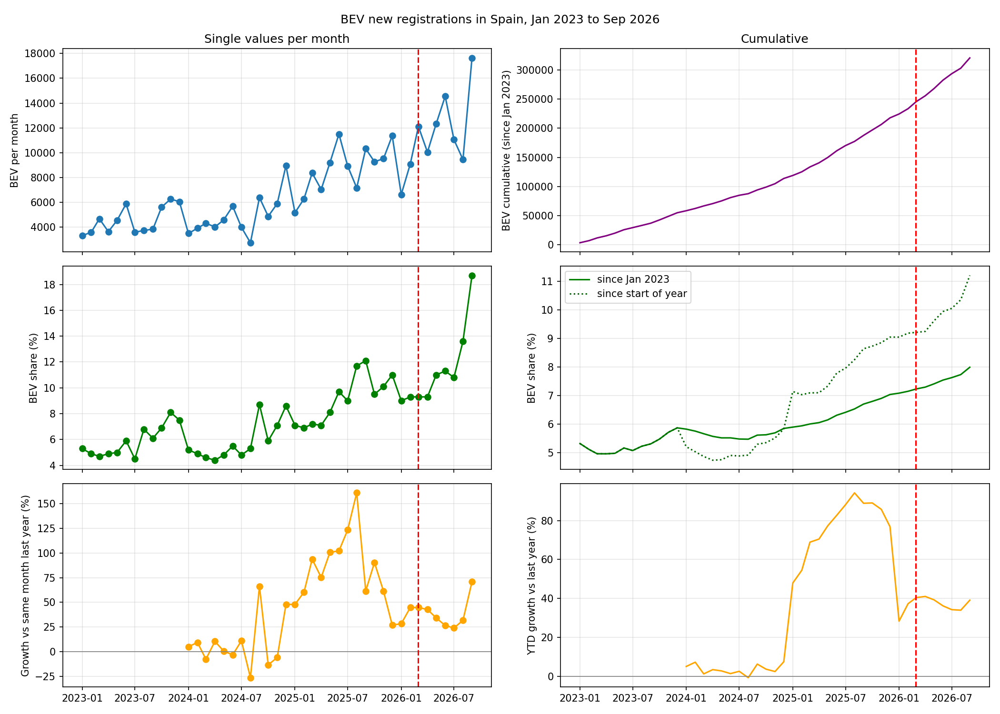
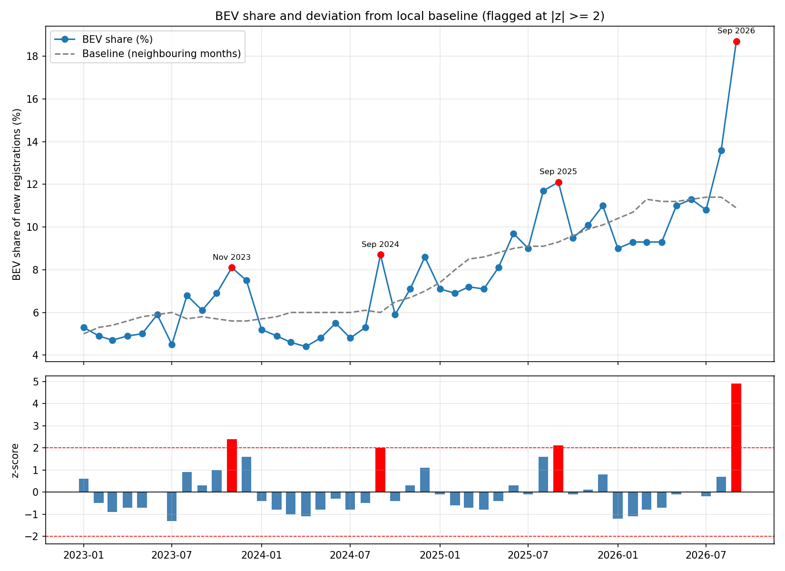
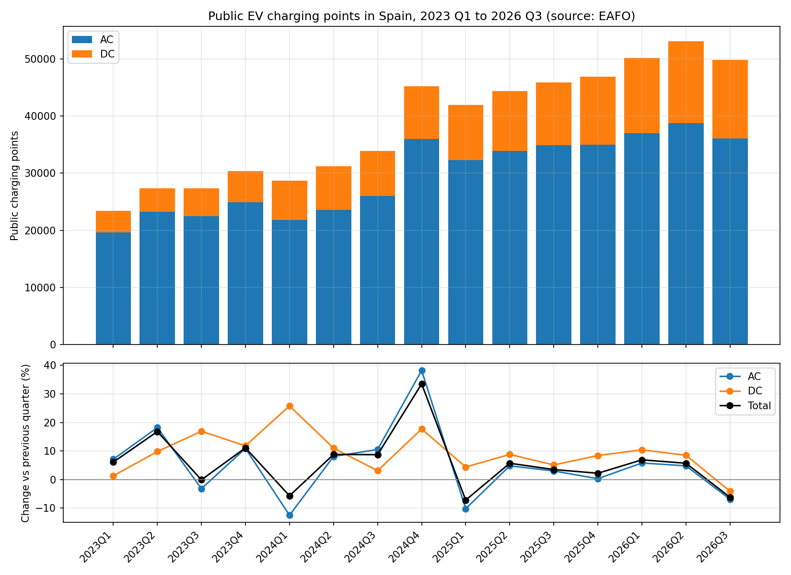
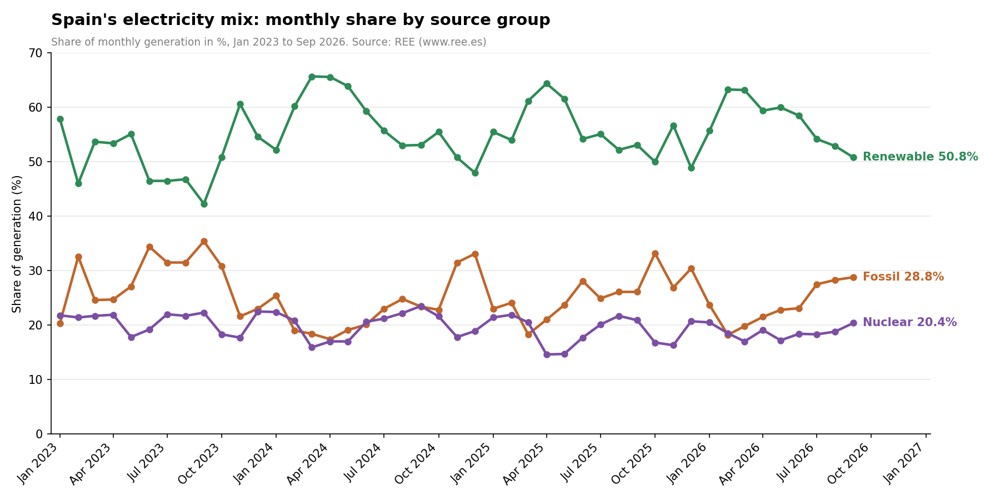

**Joined Analysis of the Questions:**

Questions:

Q1: How did new BEV registrations in Spain develop between January 2023 and September 2026, and can anomalies be linked to events?

Q2: How did the number of public charging points for electric cars in Spain change over the same period?

Q3: Where does the electricity in Spain come from, i.e. how is it generated (renewable, nuclear, fossil)?

Question 1:

Looking at  we can clearly see a strong and fairly steady growth in BEV registrations over the timespan.

The graph of the BEV share in percent shows us that this growth is not linked to just a general increase in car registrations, but especially to BEV registrations.

Noticeable in the graph comparing a month to the same month of the previous year is August 2025, we will come back to that later.

Also:  shows a spike in September of each year, plus November 2023.

Four months deviate by at least two standard deviations from their local baseline: November 2023 (z = 2.4), September 2024 (z = 2.0), September 2025 (z = 2.1) and September 2026 (z = 4.9).

Question 2:

The figure  shows the number of public charging points in Spain per quarter from 2023 Q1 to 2026 Q3, split into AC and DC (top), together with the percentage change versus the previous quarter (bottom). The total grows from about 23,400 to a peak of about 53,000 in 2026 Q2, before falling to about 49,800 in 2026 Q3.

Observations:

DC points grow in almost every quarter, while AC points fluctuate and fall in several quarters, most strongly in 2024 Q1 (-12.5 %) and 2025 Q1 (-10.2 %). AC points jump by 38.2 % in 2024 Q4, which is far outside the usual range and may reflect a change in counting rather than new construction.

Question 3:

Description:

The figure 

shows the monthly share of Spain's electricity generation from renewable, nuclear and fossil sources from January 2023 to September 2026. Renewables supply the largest share throughout, between about 42 % (September 2023) and 66 % (March 2024).

Observations:

The renewable share peaks in spring and drops in late summer and autumn, while the fossil share moves in the opposite direction, which points to a seasonal pattern. The nuclear share stays around 17-23 % but falls to about 15 % in April and May 2025, and from July to September 2026 the fossil share rises (27.5 % to 28.8 %) while the renewable share falls (54.2 % to 50.8 %).

Explanation (Q1):

The August 2025 peak (+160.9 %) is a base effect: August 2024 was unusually low (about 2,700 BEV).

In absolute terms June 2025 was the strongest month (11,502 BEV), which is why August does not show

up as an anomaly in the z-score chart.

Three of the four flagged months coincide with subsidy policy:

- September 2024: ANFAC linked the surge to the announced end of MOVES III in December 2024 (buyers

  bringing purchases forward).

- September 2025: MOVES III had been reinstated in April 2025, but ANFAC warned in the same month

  that funds were exhausted in nine regions covering 85 % of the car market.

- September 2026: Faconauto and AEDIVE credit the Plan Auto+ platform, which opened in late August 2026.

- November 2023 is the exception and was attributed to a record Tesla month (Model 3: 1,639 units).

No break is visible after the start of the Strait of Hormuz crisis on 28 February 2026.

Explanation (Q2):

The 2024 Q4 jump is most likely a counting change: AEDIVE reported only about 3,300 new points that

quarter, and 2025 Q1 reverses part of the jump. The 2026 Q3 decline matches an AEDIVE data clean-up.

Since the series is a stock, the quarterly change is a net change, not newly built points.

Explanation (Q3):

The seasonal pattern follows the weather: hydro and wind are strong in spring, while gas fills the gap

in late summer and autumn. The low nuclear share in spring 2025 is not explained by the data at hand.

Joined analysis:

- Only registrations show a clear trend. The BEV share rose from 5.3 % to 18.7 %, while the electricity

  mix stayed roughly constant and the charging network grew much more slowly.

- Cumulative BEVs per public charging point rose from 0.5 (2023 Q1) to 6.4 (2026 Q3); the real ratio is

  higher, because cars registered before 2023 are not counted.

- The anomalies line up with subsidy dates, not with the energy data. Neither the charging network nor

  the generation mix shows a matching break in those months.

Conclusion:

BEV registrations in Spain grew strongly, and their anomalies can plausibly be linked to changes in

subsidy policy rather than to infrastructure or electricity supply. The public network roughly doubled,

but two of its largest movements are data effects. The electricity mix was already largely low-carbon

in 2023 and did not improve measurably within the period. The Strait of Hormuz crisis left no visible

mark on any of the three series.

Limitations:

- Correlation, not causation: the links between anomalies and events are associations supported by

  statements of industry associations (ANFAC, Faconauto, AEDIVE), which are interested parties.

- z-score edge effect: the baseline uses the six months before and after, so the first and last six

  months are computed from truncated windows. The value for September 2026 (z = 4.9) is probably overstated.

- Small August market: in August the total number of registrations is low, which can inflate the BEV share.

- Registration data show where a car is registered, not where it is charged. Only new passenger cars

  are counted, so figures differ slightly from press figures (for example, vans are not included).

- Q2 covers only public charging points (EAFO, based on Eco-Movement data, not official statistics).

  No source for private chargers was found.

- Q2 is quarterly, Q1 and Q3 are monthly, so the series cannot be compared month by month.

- The quarter-on-quarter change in Q2 is a net change in the stock, not the number of newly built points.

- The cumulative BEVs per charging point only count cars registered since January 2023, so the real

  ratio is higher.

- Q3 excludes electricity from self-consumption installations, and REE data from July 2025 onwards are provisional.

- Electricity cannot be traced physically to a power plant, so the mix applies statistically to the

  whole grid, not to individual charging points.

- Imports are left out of Q3. Spain is a net exporter, but this was not checked with an own time series.

Sources (retrieved October 2026):

Data

- DGT, microdata on vehicle registrations (monthly files, Jan 2023 - Sep 2026): https://www.dgt.es/microdatos/

- EAFO, European Alternative Fuels Observatory, public charging points in Spain (quarterly, AC and DC): https://alternative-fuels-observatory.ec.europa.eu/

- REE, REData, generation structure by technology (monthly, exported 25 Oct 2026): https://www.ree.es/en/datos/generacion/estructura-generacion

Context (retrieved 26 Oct 2026)

- Registrations September 2024: https://www.diariomotor.com/noticia/matriculaciones-septiembre-2024-tesla-model-3/

- Registrations November 2023: https://movilidadelectrica.com/matriculaciones-coches-electricos-noviembre-2023/

- Registrations September 2025: https://www.interempresas.net/Estaciones-servicio/611298-vehiculos-electrificados-suman-21-por-ciento-del-mercado-con-mas-de-22000-ventas-en.html

- MOVES III funds exhausted in nine regions (ANFAC, 18 Sep 2025): https://www.bolsamania.com/noticias/ultimas/economiamotor--anfac-senala-su-preocupacion-por-el-agotamiento-de-los-fondos-del-plan-moves-iii-en-nueve-comunidades--20907362.html

- Registrations September 2026 and Plan Auto+: https://noticias.coches.com/noticias-motor/matriculaciones-septiembre-2026/575204

- BEV sales September 2026 (AEDIVE, Ganvam): https://www.energias-renovables.com/movilidad/los-particulares-compran-el-72-5-de-20261001

- AEDIVE charging points end of 2024 (about 3,300 new points in Q4): https://www.energias-renovables.com/movilidad/la-red-de-infraestructuras-de-recarga-pnblica-20250115

- AEDIVE charging points August 2026 (data clean-up): https://movilidadelectrica.com/puntos-de-recarga-espana-agosto-2026/

- Strait of Hormuz crisis, start on 28 Feb 2026: https://en.wikipedia.org/wiki/2026_Strait_of_Hormuz_crisis

